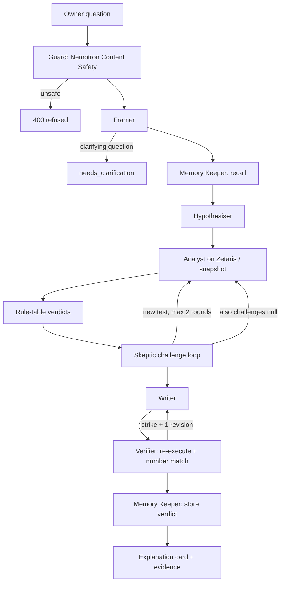
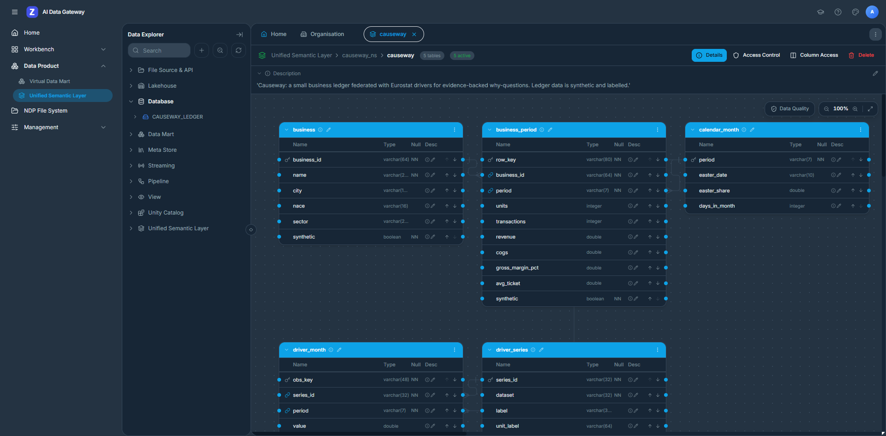

# Causeway — the agent that explains why, with evidence

Causeway answers **"why did this metric change?"** for small-business owners and their accountants — by testing rival explanations against the owner's books and public statistics, and showing the evidence behind every sentence.

| | |
|---|---|
| **Track** | Open Agent Hackathon 2026 · Track 02 — The Agent That Can Explain Why |
| **Team** | Rui Codex |
| **Licence** | Apache-2.0 |
| **Repo** | https://github.com/RuiCodex-dev/open-agent-causeway |
| **Video** | https://youtu.be/AyXejKr6Fyc (3:09, unlisted) |
| **Deck** | [deck/Causeway-deck.pdf](deck/Causeway-deck.pdf) |

---

## 1. Quick start (60 seconds, no keys)

```bash
docker compose up --build
```

Then open **http://localhost:8080**, or:

```bash
curl -X POST localhost:8000/run \
  -H 'content-type: application/json' \
  -d @input_examples/example_1.json
```

With an empty `.env` this is **sample mode**: the bundled Zetaris snapshot (DuckDB) plus the deterministic offline reasoner. The full agent loop runs — Framer, Hypothesiser, Analyst, Skeptic, Writer, Verifier, Memory Keeper — with real SQL, statistics and rule-table verdicts. Nothing is replayed from a saved answer.

### Enable a live model

**Meterless Nightshift** (the primary provider; add your NVIDIA key in Nightshift → Setup → Providers) is configured further down. **NVIDIA Nemotron directly** (free key from [build.nvidia.com](https://build.nvidia.com)):

```bash
# in .env
MODEL_PROVIDER=nvidia
MODEL_API_KEY=your-nvidia-key-here
```

**Meterless Nightshift** (Runtime 1.4; the token is in Nightshift's `proxy-token` file or its connect link):

```bash
MODEL_PROVIDER=meterless
METERLESS_RUNTIME_TOKEN=your-runtime-token-here
METERLESS_BASE_URL=http://127.0.0.1:8088/v1
METERLESS_MODEL=nvidia/nemotron-3.5-lightning-30b-a3b   # optional lane pin; omit for meterless/auto
MODEL_API_KEY=your-nvidia-key-here                      # optional: input guard + failover
```

Nightshift listens on 127.0.0.1 by default, so run Causeway on the same host (`npm run dev`) to use it; the Docker image was validated with NVIDIA direct and with the offline reasoner.

See `.env.example` for all options (Nebius failover, Zetaris live credentials, pacing).

---

## 2. The problem and the users

**Users:** owner-managers of small Belgian businesses, and the accountants who advise them.

**Question they ask every quarter:** why did margin or revenue move?

Their own ledger lives in one place; the public drivers that might explain the move (cocoa prices, energy, tourism, retail volume, bankruptcies) live in Eurostat. Chatbots can write a paragraph about "possible reasons", but the numbers are unverifiable and rival explanations are never tested.

Causeway treats the question as an investigation: propose rivals, test them on federated data, challenge supported answers, and only show claims whose numbers survive re-execution.

---

## 3. What it does

**Principle: models propose, code decides.** No model writes SQL, computes a statistic, or issues a verdict. SQL comes only from `src/tests/compiler.ts` templates; statistics only from `src/stats/`; verdicts only from the rule table in `src/stats/rules.ts`.



### The agents

| Agent | Model | Authority |
|---|---|---|
| **Guard** | `nvidia/nemotron-3.5-content-safety` | Refuses unsafe questions before any agent runs (deny-list fallback without an NVIDIA route) |
| **Framer** | `nvidia/nemotron-3.5-lightning-30b-a3b` | May stop the run with one clarifying question |
| **Hypothesiser** | Nemotron 3.5 via Meterless Nightshift (Super VL 120B when calling NVIDIA directly) | Proposes rival hypotheses from the typed cause catalogue |
| **Analyst** | *(none — code)* | Compiles tests to SQL, runs them on Zetaris, computes statistics, applies the rule table |
| **Skeptic** | Nemotron 3.5 via Meterless Nightshift (Super VL 120B when calling NVIDIA directly) | Veto: a supported verdict must face an untested confounder test; also challenges the null ("nothing explains it") |
| **Writer** | Nemotron 3.5 via Meterless Nightshift (Super VL 120B when calling NVIDIA directly) | Writes the explanation card; every claim cites evidence |
| **Verifier** | *(none — code)* | Veto: re-executes cited SQL and strikes numbers not in the evidence |
| **Memory Keeper** | *(none — Meterless H-MEM)* | Recalls and stores owner facts and verdicts |

With no model key, Framer / Hypothesiser / Skeptic / Writer use deterministic offline paths; Analyst, Verifier and Memory Keeper are always code.

---

## 4. The demo case

**Business:** Atelier Noir — a synthetic Ghent chocolatier. Drivers are real Eurostat series federated through Zetaris.

**Question** (`input_examples/example_1.json`): *"Why did our gross margin fall in the first half of 2025?"*

Without an owner fact in memory, the agent supports **cocoa-driven input costs**, rules out Easter and energy as explanations for this move, and treats the shop's own price rise as an **offset**.

**Memory changes the answer.** `supplier_change` is only in the catalogue when an owner-confirmed fact exists (`needs_fact`). After the owner confirms *"We switched to a more expensive single-origin couverture supplier in May 2025"* (Memory Keeper / UI memory panel), a re-ask also tests and can support **supplier change** alongside cocoa (bench case B02). The same question, new evidence from memory — not a replayed script.

---

## 5. Sponsor technology

### Zetaris — only live data path

Every number in an answer comes from a Lightning SQL query; the Verifier re-executes it before the claim is shown.

| Object | What it holds |
|---|---|
| Datasource `CAUSEWAY_LEDGER` | Synthetic owner ledger (PostgreSQL) |
| Lightning DB `EUROSTAT_REST` | 7 Eurostat REST tables (Belgium) |
| USL `lightning.metastore.causeway_ns.causeway` | 5 tables, 4 foreign keys: `business`, `business_period`, `calendar_month`, `driver_series`, `driver_month` |



Details: [`docs/zetaris/README.md`](docs/zetaris/README.md). Reflection (time saved, beyond the hackathon, feedback): [`docs/zetaris/USL_REFLECTION.md`](docs/zetaris/USL_REFLECTION.md).

Parity: same compiled SQL on live Zetaris and on the snapshot is hash-identical for 5/5 USL tables and 3/3 join queries (`docs/evidence/parity-2026-10-22.txt`). A full live investigation produced 14 evidence queries whose hashes match the snapshot run (`docs/evidence/cp2-live-zetaris-run.json`).

### Meterless — World Model, H-MEM, Markovian, Runtime provider

| Engine | Role | Code | Log evidence |
|---|---|---|---|
| **World Model** | Shared evidence graph (hypotheses, evidence, verdicts, challenges, claims, owner facts) with provenance | `src/meterless/worldModel.ts`, `vendor/meterless/world-model/` | `logs/worldmodel-*.jsonl` |
| **H-MEM** | Cross-session owner facts, verdict history, feedback, append-only trust ledger; recall before the Hypothesiser | `src/meterless/memory.ts`, `vendor/meterless/hmem/` | `logs/hmem-ledger.jsonl` |
| **Markovian** | Bounded Hypothesiser–Skeptic–Writer dialogue with compressed carryover between rounds | `src/meterless/loop.ts`, `vendor/meterless/markovian/` | `logs/markovian-*.json` |

Every model call goes through `src/meterless/generator.ts`. Conformance of the vendored engines: `docs/evidence/conformance-world-model.txt`, `conformance-hmem.txt`, `conformance-markovian.txt`.

**Meterless Nightshift is the primary AI provider** (`MODEL_PROVIDER=meterless`, the default): `src/models/providers/meterless.ts` (Runtime 1.4, provider contract v4), built in Cursor session S2 and unit-tested against the contract. The demo and the Bench run through **Nightshift 1.2.3 on Windows** (installed on 2026-10-23 after its published SHA-256 matched the downloaded installer; the earlier 1.2.1 listing had two disagreeing values, so we waited). Nightshift holds the NVIDIA key in its own provider settings and routes every Framer, Hypothesiser, Skeptic and Writer call; its signed receipts record the routed model for each call. Three integration details, each found on the live runtime:

- **One scope per investigation.** Nightshift adds memories from its own H-MEM to prompts and caches answers, both walled by `meterless-scope`. Under the default `user` scope its receipts showed `hmem.injected: 2` on our calls, and one run named a "supplier change" that the owner had never reported. Causeway now sends `meterless-scope: causeway-<run_id>`, so no run sees another run's memory or cached answer, and Causeway's own per-business H-MEM stays the only memory the agents use (receipts after the change: `context_sources: ["messages"]`, cache miss).
- **Thinking off for structured calls.** Without `chat_template_kwargs.enable_thinking=false` the Nemotron lanes can spend the whole token budget on reasoning and return empty (HTTP 502 from the runtime).
- **Lane pinned to Nemotron 3.5 Lightning** (`METERLESS_MODEL`). Nightshift lists Nemotron 3.5 Super VL as temporarily excluded, and the Ultra 550B lane worked but took ~97 s for one Skeptic call. `meterless/auto` also works; the pin keeps the demo under 30 s.

The input guard (Nemotron Content Safety) is not a Nightshift lane, so it calls NVIDIA directly when a key is set (deny-list otherwise). `MODEL_PROVIDER=nvidia` and Nebius failover use the same OpenAI-compatible seam.

### NVIDIA — Nemotron roles, failover, pacing

| Role | Through Meterless Nightshift (demo, Bench) | NVIDIA direct (`MODEL_PROVIDER=nvidia`) |
|---|---|---|
| Reasoner (Hypothesiser, Skeptic, Writer) | `nvidia/nemotron-3.5-lightning-30b-a3b` (pinned lane) | `nvidia/nemotron-3.5-super-vl-120b-a12b` |
| Fast (Framer) | `nvidia/nemotron-3.5-lightning-30b-a3b` | `nvidia/nemotron-3.5-lightning-30b-a3b` |
| Input guard | `nvidia/nemotron-3.5-content-safety` (direct; not a Nightshift lane) | `nvidia/nemotron-3.5-content-safety` |
| Failover | NVIDIA direct, then Nebius | Nebius `nvidia/nemotron-3-super-120b-a12b` |

Access: hosted on build.nvidia.com (`integrate.api.nvidia.com/v1`); Nebius Token Factory as failover; no local GPU. Client-side pacer (default 32 req/min, burst 8, concurrency 3) for the free tier. Files: `src/models/providers/openaiCompat.ts`, `src/models/router.ts`, `src/models/pacer.ts`.

### Cursor — rules, sessions, trailer

- Committed rules: `.cursor/rules/` (architecture, secrets, testing, UI).
- Headless `cursor-agent` sessions, each reviewed and logged under `docs/cursor-sessions/`:
  - **S1** — project scaffold
  - **S2** — Meterless Runtime provider (Power rule)
  - **S4** — web UI
  - **S5** — this README draft
- Commits from a session carry the trailer `Cursor-Session: S<n>`.
- A human-reviewed AI coding assistant was also used alongside Cursor for implementation and review.

### What was unique

Rival hypotheses are bound to a typed catalogue; SQL and verdicts are never model-written; a Skeptic with veto power also challenges the null; every shown number is re-queried; owner memory can unlock a new cause on re-ask; the same portable SQL runs on Zetaris Lightning and on the Zetaris-sourced snapshot.

---

## 6. Modes and live Zetaris

| Mode | How |
|---|---|
| **Sample** (default with empty `.env`) | `SAMPLE_MODE=true` or no Zetaris credentials → snapshot + DuckDB; offline reasoner unless a model key is set |
| **Live** | `ZETARIS_REST_URL` + `ZETARIS_API_KEY` + `ZETARIS_ORG_ID`; `SAMPLE_MODE=false` forces live (fails if unreachable) |
| **Auto** | Credentials set, `SAMPLE_MODE` empty → try Zetaris; on failure, failover to snapshot and log `data_failover` |

Recreate the stack on your own Zetaris instance:

```bash
bash scripts/ledger-up.sh                    # Postgres ledger on the Zetaris docker network
npx tsx scripts/onboard.ts --run             # datasource, REST tables, USL
npx tsx scripts/snapshot.ts                  # refresh Parquet snapshot through Zetaris
npx tsx scripts/parity.ts --live             # hash-compare live vs snapshot
```

---

## 7. Usage

### `POST /run` (sync)

Request:

```json
{
  "run_id": "optional",
  "input": { "question": "Why did our gross margin fall in the first half of 2025?", "business_id": "atelier-noir" },
  "options": { "max_rounds": 2 }
}
```

Response (short): `status` (`success` | `needs_clarification`), `frame`, `output` (verdict, chain, verified claims, rejected, offsets, limitations, memory used), `hypotheses` with rule-table verdicts, `challenges`, `evidence` (SQL, rows preview, sha256), `verification`, `markovian`, `world_model`, `memory`, `execution_time_seconds`, `data_mode`, `reasoner`.

### Async + SSE

- `POST /runs` → `{ run_id, events, result }`
- `GET /runs/:id/events` — Server-Sent Events (trace lines, then result)
- `GET /runs/:id` — finished result

### CLI, Python, UI

```bash
npm run ask -- "Why did our gross margin fall in the first half of 2025?" --business atelier-noir
python run.py --input input_examples/example_1.json          # via CLI (Node 22)
python run.py --input input_examples/example_1.json --api    # POST to running API
```

UI: http://localhost:8080

### Input examples

| File | Business | What it shows |
|---|---|---|
| `example_1.json` | atelier-noir | Hero margin question; cocoa supported; Easter/energy ruled out; own price as offset |
| `example_2.json` | cafe-sablon | Tourism recovery (Brussels café, Q2 2022 vs Q2 2021) |
| `example_3.json` | velo-schelde | Bike units fall driven by Belgian retail volume |
| `example_4.json` | fleur-leuven | Null control: noise only; expect no external cause supported |
| `example_5.json` | atelier-noir | Ambiguous *"Why are things bad lately?"* → `needs_clarification`, one question, no guess |

---

## 8. Evaluation — Causeway Bench

**Method:** synthetic businesses driven by real Eurostat series; ground truth is the generator's parameters (`scripts/businesses.ts` / `bench/truth/`), which `src/` never reads. Tune / holdout split; null controls (no planted external cause). Measures recovery of known synthetic causes — **not** real-world causality.

Harness: `npx tsx scripts/bench.ts [--offline]`. Run history and what changed between runs: [`bench/RUNS.md`](bench/RUNS.md).

### Summary (Nemotron through Meterless Nightshift, from `bench/report.md`)

Generated by `scripts/bench.ts` at 2026-10-26T02:57:13Z on commit `ac24f0c`. Reasoner: Nemotron 3.5 Lightning routed by Meterless Nightshift 1.2.3. Data: Zetaris snapshot via DuckDB.

| Split | Cases | Main cause found | All causes found | False supports / case | Null controls passed | Ungrounded numbers in final prose | Verifier strikes | Skeptic challenges | Mean time |
|---|---|---|---|---|---|---|---|---|---|
| All | 12 | 100% | 100% | 0.08 | 2/2 | 0 | 1 | 7 | 11.3s |
| Tune (cases used while setting thresholds) | 5 | 100% | 100% | 0.00 | 1/1 | 0 | 0 | 4 | 10.5s |
| Holdout (never used to set thresholds) | 7 | 100% | 100% | 0.14 | 1/1 | 0 | 1 | 3 | 11.8s |
| Clean holdout (also never prompted a code change: B05, B09, B10, B11) | 4 | 100% | 100% | 0.25 | 1/1 | 0 | 0 | 2 | 12.8s |

Verifier strikes are claims the Verifier rejected before the owner saw them (here: one number that is in no evidence); it was rewritten in the Writer's one revision. Supported causes were identical in five consecutive runs (runs 6–10 in `bench/RUNS.md`). The NVIDIA-direct run of 10-22 is kept as `bench/report-nvidia-2026-10-22.md` (same headline numbers).

**Honest limits of this eval:** holdout cases B03, B08 and B12 each prompted a fix (B12 on 10-23: the Framer model read "gross margin" as revenue, and code now decides any metric the question states), so they are no longer clean holdouts; `bench/RUNS.md` records every run, including the one where B12 was missed (11/12). Association is not causation. Thresholds (e.g. material-change 3 %) were set on the tune split. **Clean holdout case B11 records a false support in every run** (`sector_distress`: Belgian retail bankruptcies rose 11 % and the synthetic sales track them at r = 0.54, enough to pass a rule that a shared trend can satisfy); we report it rather than tune the rule after seeing the case.

---

## 9. Logs and traces

| File | Contents |
|---|---|
| `logs/trace-<run>.jsonl` | Every agent action (queries, model calls, challenges, strikes, failover) |
| `logs/worldmodel-<run>.jsonl` | World Model event log and audit trail for the investigation graph |
| `logs/hmem-ledger.jsonl` | Append-only H-MEM trust ledger (recall, add_fact, remember_verdict, feedback) |
| `logs/markovian-<run>.json` | Markovian round report (carryover, estimated token efficiency, labelled "estimated") |

---

## 10. Failure handling

| Failure | Behaviour |
|---|---|
| Zetaris unreachable | In auto mode: failover to the bundled snapshot (`data_failover`); if `SAMPLE_MODE=false`, hard fail |
| Model 429 / 5xx | Full-jitter back-off; circuit breaker; failover to Nebius when configured; agents then fall back to the offline reasoner for that step |
| Invalid model JSON | Exactly one repair turn (`generateJson` in `src/meterless/generator.ts`) |
| Ambiguous question | Framer returns `needs_clarification` with **one** clarifying question — no guessed investigation |

---

## 11. Data and licences

**Eurostat** (re-use with attribution), datasets:

`prc_hicp_midx`, `prc_hicp_minr`, `nrg_pc_205`, `nrg_pc_203`, `sts_trtu_m`, `tour_occ_nim`, `sts_rb_q`

Live via Zetaris REST tables; cached in `data/snapshot` (see `data/snapshot/manifest.json`: USL tables read through Zetaris Lightning, Parquet + sha256 per table).

**Business ledgers:** synthetic, generated by `scripts/gen-ledgers.ts`, labelled `synthetic` in every row. Ground truth under `bench/truth/` is never read by `src/`.

---

## 12. AI and model usage disclosure

| Use | What |
|---|---|
| Runtime reasoners | NVIDIA Nemotron (or Meterless Runtime / offline) for Framer, Hypothesiser, Skeptic, Writer only |
| Coding | Cursor (rules + headless sessions S1–S5) and a human-reviewed AI coding assistant alongside Cursor |
| Not used for | SQL generation, statistics, verdicts, verification |

### Responsible AI

- Not financial, tax or investment advice.
- Supported associations are rule-table outcomes on observational series — **association is not causation**.
- A human should review the explanation card and open the evidence drawer before acting.
- Synthetic demo businesses are always labelled synthetic in the UI and API.

---

## 13. Limitations

- Cause catalogue is closed: the model cannot invent a new test; only catalogue causes are investigated.
- `supplier_change` requires an owner fact; without memory it will not be proposed.
- Material-change and association thresholds were tuned on a small tune set; see `bench/RUNS.md`.
- Eurostat energy (half-year) and bankruptcies (quarter) are rolled down to months; grain mismatch is kept in `source_period`, not hidden.
- Sample mode uses a point-in-time snapshot, not live Eurostat.
- Offline reasoner is deterministic but less nuanced in prose than Nemotron.
- Bench proves recovery of planted synthetic causes, not causal discovery in the wild.
- Single-language (English) product surface.

---

## 14. Pre-existing components and repository layout

### Pre-existing (from `metadata.json`)

- Design documents written 2026-10-15..18 before the window (no product code)
- Meterless reference engines @0aa7417 (Apache-2.0, vendored unmodified under `vendor/meterless`)
- Pattern of the Zetaris getting-started Eurostat JSON-stat recipe @44668b2 (Apache-2.0); our SQL is generated in the window

### Layout

```
src/agents/          Framer, Hypothesiser, Analyst, Skeptic, Writer, Verifier, catalogue
src/meterless/       World Model, H-MEM, Markovian adapters + generator seam
src/models/          Router, pacer, NVIDIA / Nebius / Meterless providers
src/tests/           SQL compiler templates
src/stats/           Statistics + rule table
src/adapters/        Zetaris REST + snapshot DuckDB
src/orchestrator/    Investigation state machine
src/api/             Fastify :8000
ui/                  Vite React UI :8080
vendor/meterless/    Unmodified reference engines
zetaris/sql/         Onboarded datasource / REST / USL SQL
data/snapshot/       Bundled Zetaris USL snapshot + manifest
input_examples/      Judge-ready requests
bench/               Report, RUNS.md, truth (not read by src/)
docs/zetaris/        Zetaris docs, ERD, USL reflection
docs/cursor-sessions/ S1–S5 session logs
docs/evidence/       Parity, conformance, live/snapshot run artefacts
scripts/             onboard, snapshot, parity, bench, ledger-up, …
```
